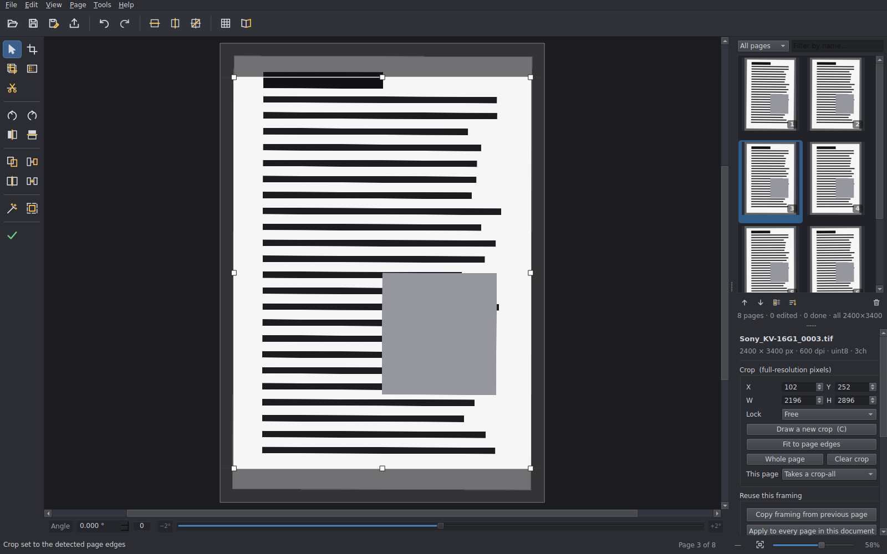

# ScanForge

A crop, straighten and align bench for high-resolution archival scans.

Built for 600 dpi TIFFs of vintage brochures and manuals — a page is
10000 × 14000 px and 140 megapixels, which is the size at which GIMP and
Paint.NET start swimming. ScanForge stays responsive because it never edits the
full-resolution image: every adjustment is recorded against the untouched scan
and applied once, at export.



---

## What it does

* **Non-destructive.** Your scans are never written to. A project file records
  every crop, angle and blur; the originals stay exactly as the scanner left
  them.
* **One document, not a folder of files.** The whole queue is treated as pages
  of a single brochure or manual — one document name, one shape, one export.
* **Crop and straighten to the pixel and the hundredth of a degree**, with page
  edge detection and text-line deskew to do the first pass for you.
* **Fix the awkward scans.** Cut one sheet into several pages, join two
  overlapping passes into one page, align facing pages against each other.
* **Reorder, filter and mark off** a two-hundred-page queue as you work through
  it.
* **Proof it as a book** before you export, two facing pages at a time.
* **Export** numbered TIFFs, a zip, and a PDF, in one pass.

Windows-first (the batch files and the packaging assume it), but the
application itself is plain PySide6 and runs anywhere Qt does.

---

## Why it stays responsive

The short version — the reasoning and the measurements are in
[docs/design-notes.md](docs/design-notes.md):

* **Each scan is decoded once, ever.** Three reduced copies (320 / 2200 /
  5200 px) go into a cache under `%LOCALAPPDATA%\ScanForge`. Re-opening a page
  afterwards is a 50 ms JPEG decode instead of a 10-second TIFF decode.
* **Editing happens on the 2200 px proxy**, and rotation is a Qt transform
  rather than a resample, so dragging the angle slider redraws in single-digit
  milliseconds whether the source is 4 MP or 140 MP.
* **Nothing slow runs on the interface thread**, only so many decodes run at
  once, and the number is sized from the free memory on the machine.
* **Full resolution is touched once, at export.**

| Operation | Time |
|---|---|
| First open of a 10000 × 14000 TIFF (builds the proxies) | 1.5 s |
| Re-open from cache | 50 ms |
| Auto-deskew | 0.24 s |
| Full-res render and write of one 140 MP page | 12–15 s |

Measured on a 2-core container; your machine will be quicker.

---

## Getting started

1. Install Python 3.10 or newer from python.org, ticking **Add python.exe to
   PATH**.
2. Double-click **`setup.bat`**. It builds a private `.venv` in the app folder
   and installs PySide6, OpenCV, tifffile, imagecodecs, NumPy and Pillow.
   Nothing goes in system-wide.
3. Double-click **`run.bat`**.

`run-console.bat` is the same but leaves a console open, which is what you want
if something goes wrong. `run-tests.bat` runs the test suites.

To make a copy for someone without Python, run **`build-exe.bat`** — see
[Building an executable](#building-an-executable) below.

---

## The workflow

**1 · Drop the folder on the window.** Anywhere in it. That folder becomes the
working folder: it sets the document name, seeds the file dialogs, and puts the
default export destination beside the scan folder rather than inside it. Loose
files work too, and dropping a `.sfproj` opens that project. A modal window
reads every page before you can touch anything, with a real per-page
percentage.

**2 · Frame the pages.** A page you have not cropped shows a crop window around
the whole sheet with handles on it, so cropping usually starts by pulling that
frame in. **Fit to page edges (E)** finds the sheet against the scanner bed and
does it for you. Two crop tools decide how far a rectangle reaches:

* **Crop page (C)** — this page only.
* **Crop all pages (Shift+C)** — draw once, give it to every page.

Both release themselves after one drag, and neither arms itself: a new project
opens on the cursor. Per-page settings decide who *receives* a crop-all —
**follows** (the default), **keeps its own position** (same size, doesn't move),
or **locked** (sits out entirely, in both directions).

For crops that are a few pixels apart rather than wrong, **Match crop sizes
(Ctrl+Shift+M)** brings a group onto one exact size by resizing each about its
own centre, so the sizes change and the framing does not move.

**3 · Straighten.** Four ways, in rough order of how often you'll want them:

* **Guides (Space, Shift+Space)** drop a level or upright cyan line across the
  view. Put it on a baseline or a margin and turn the page onto it.
* **Auto-deskew (D)** reads the text lines — 0.1° sweep, then 0.01° refinement.
* **The angle slider** under the canvas spans ±2.000°, so one screen pixel is
  about 0.01°. The box beside it takes three decimals directly.
* **`[` and `]`** rotate 0.01° per press, 0.10° with Shift.

Guides sit in the page's coordinates, so they stay on the feature you put them
on as you pan and zoom, and they stay put when you change pages — a whole
document can be squared against one reference.

**4 · Deal with the awkward ones.**

* **Cut (X)** splits one scan into several pages along a line you place — a
  fold-out, two pages caught on one sheet, a strip of panels. Shift cuts across
  instead of down; **Page ▸ Cut into pages** does measured halves, thirds and
  quarters. You get *n* pages over the same file, each with its own crop.
  Nothing is written to disk.
* **Join (Ctrl+Shift+J)** is the inverse: a page too big for the platen,
  scanned in two overlapping passes. Align the two, trim each inner edge, and
  they become one page that exports as one file. The sources stay separate on
  disk.
* **Align as a spread (Ctrl+J)** butts two facing pages together at the gutter
  in the main work area. Nudge, rotate, match heights, run a guide across both,
  or **link** the two crop frames so they stay the same size. Nothing is
  merged — the spread is a viewing aid, and the pages stay two files.

Cut pieces, joined pages and spread-aligned pages are **locked** automatically,
so a later crop-all cannot undo work you did by hand.

**5 · Blur what shouldn't ship.** **B** and drag over a previous owner's name, a
price sticker, a serial number. What you see is a real blur of the actual
pixels, not a grey box standing in for one, so you can tell whether it's strong
enough before you export. Blur or pixelate, adjustable strength, as many per
page as you like.

**6 · Put them in order.** Raw scans rarely come off the scanner in reading
order, so the grid is editable: drag to reorder (the pages lift out and a slot
opens where they'll land), Ctrl+M to move to a numbered position, sort by name,
date or size, Delete to remove pages from the queue without touching the files.
Each page shows its position in the corner and a line of text saying only what
has been *done* to it — *edited*, *locked*, *spread*, *done* — so the pages that
need attention are the ones that say something.

**7 · Proof it as a book (Ctrl+P).** Everything else looks at one page at a
time, which is right for cropping and wrong for answering "is this actually
correct?". This shows the *rendered* pages the way a reader meets them, two at a
time with a page turn — so a page that is upside down, out of order or missing
becomes obvious. The book is fitted once from the largest pair in the document,
so it doesn't breathe as you turn it.

**8 · Export (Ctrl+E).** Type the document name and you get:

```
…\edited\Sony_KV-16G1\
    Sony_KV-16G1_0001.tif
    Sony_KV-16G1_0002.tif
…\edited\
    Sony_KV-16G1.pdf
    Sony_KV-16G1-images.zip
```

A preset dropdown drives the naming with a live preview of the actual file
names, and the **Pattern** box takes `{doc}`, `{page}`, `{name}` and `{index}`
if you want a different shape. Options: TIFF compression, bit depth,
resolution, a JPEG preview beside each TIFF, and the number of parallel workers
(2 is the sweet spot — each holds a full page in memory, ~420 MB).

The individual page files are **not kept by default**, since the project file
already records everything against the untouched scans and a set of 600 dpi
TIFFs is several gigabytes to leave lying around. Tick **Keep the individual
page files as well** when you want them.

---

## The window

```
 ┌─────────────────────────────────────────────────────────────┐
 │  open save save-as export │ undo redo │ guides │ grid book  │
 ├──────┬───────────────────────────────────┬──────────────────┤
 │      │                                   │                  │
 │ tool │          the scan                 │   page grid      │
 │ col  │                                   │                  │
 │      ├───────────────────────────────────┼──────────────────┤
 │      │  angle  0.000°  0  ──────●──────  │   crop numbers   │
 │      │                                   │   and framing    │
 ├──────┴───────────────────────────────────┴──────────────────┤
 │  status · page 3 of 240 · x,y · [fit] ────●──── 61%         │
 └─────────────────────────────────────────────────────────────┘
```

Left to right in the order the work flows. The **top bar** is the document and
the view — open, save, export, undo, guides, grid, book — and nothing in it
changes a page. The **tool column** is everything that acts on the page, so it
sits beside the page: four tools (cursor, crop page, crop all, blur, cut), then
orientation, then framing that reaches past this page, then the automatic pass,
then *done*. The **page grid** is on the right, where you look to see where you
are in the document rather than what you are doing to one sheet of it. The
**status bar** carries the zoom slider and a fit button.

The panel under the page grid is a holding position: the crop numbers, reuse
buttons and blur controls have not been given permanent homes yet.

---

## Keyboard reference

Press **F1** in the app for this list.

```
TOOLS
  V                   cursor - pan, zoom, adjust an existing crop or blur
  C                   crop this page - one drag, then it releases
  Shift+C             crop every page in the project
  B                   blur - drag out a blur over something on the page
  X                   cut - split this scan into separate pages
  Del                 delete the selected blur
  Esc                 back to the cursor

NAVIGATION
  Ctrl+←  Ctrl+→      previous / next page
  Enter               mark done and go to next
  Ctrl+Enter          mark done / not done
  wheel               scroll down the page
  Shift+wheel         scroll across
  Ctrl+wheel          zoom at the cursor
  Ctrl++  Ctrl+-      zoom in / out
  middle-drag         pan
  F                   fit page

STRAIGHTENING
  D                   auto-deskew from the text lines
  [  ]                rotate by 0.01°     Shift+[ ]   by 0.10°
  Space  Shift+Space  drop a level / upright guide to judge the page against

CROPPING
  arrows              nudge 1 px   (Shift = 10 px, Alt = resize)
  E                   fit crop to the detected page edges
  A                   auto straighten and crop
  Ctrl+D              clear crop

CUTTING AND JOINING
  X                   place a cut line - Shift cuts across instead of down
  Page > Cut          measured cuts: halves, thirds, quarters
  Ctrl+Shift+J        join two scans into a single page

QUEUE
  Delete              remove selected pages (files on disk are untouched)
  drag                reorder
  Ctrl+Shift+↑ ↓      move selected pages up / down
  Ctrl+M              move selected pages to a chosen position
  right-click         document name, spread, move to position/top/bottom, reveal

BATCH
  Ctrl+B              copy framing from previous page
  Ctrl+Shift+B        apply this framing to selected pages
  Ctrl+G              set the document name
  Ctrl+J              align two pages as a spread
  Ctrl+Shift+M        match crops within a few pixels of each other
  Ctrl+E              export

HISTORY
  Ctrl+Z  Ctrl+Y      undo / redo
```

Undo covers everything, including the batch operations — applying framing
across a document, sorting, reordering, removing pages, a spread alignment.
Drags and slider scrubs coalesce into one history entry rather than hundreds.

---

## Building an executable

Run **`build-exe.bat`**. It brings the venv up to date, self-tests the source,
builds with PyInstaller, then **runs the built executable's own self-test before
declaring success** — a frozen build can import perfectly from source and still
be missing a C extension, and only running the real .exe proves otherwise. You
get `dist\ScanForge\ScanForge.exe` and `dist\ScanForge-windows.zip`; whoever you
send it to unzips it and runs the exe, with no Python on their machine.

| Argument | Effect |
| --- | --- |
| `onefile` | One self-contained exe instead of a folder. Smaller to send, but it unpacks itself on every launch, so it starts several seconds slower. |
| `quick` | Skip the source self-test, if you have just run `run-tests.bat`. |
| `nopause` | Don't wait for a keypress, for calling from another script. |

Expect roughly 300 MB unpacked, most of it Qt, OpenCV and the TIFF codecs. The
exe is unsigned, so Windows SmartScreen warns the first time ("More info" → "Run
anyway").

`ScanForge.exe --selftest` runs the checks any time, and
`python tools\freeze_check.py` runs the same ones against the source tree. The
report is written to a file as well as printed, because a windowed PyInstaller
build has no stdout to print to.

---

## How it's put together

```
scanforge/
  geometry.py      rotation maths and the coordinate spaces - the contract
                   the preview and the exporter both obey
  model.py         PageEdit / Project, the non-destructive edit record,
                   crop propagation, blurs, cutting and joining, ordering
  history.py       undo/redo by whole-project snapshot
  imageio_util.py  TIFF read/write preserving bit depth, channels, DPI, ICC
  proxycache.py    the three-tier proxy pyramid and its disk cache
  render.py        full-resolution render (crop before rotate), and the
                   assembly of a joined page from its parts
  autodetect.py    page-edge detection, projection-profile deskew
  export.py        batch runner, naming, PDF assembly
  ui/
    icons.py       every icon and the app mark, drawn from code - no assets
    loader.py      background decoding and one-off worker tasks
    canvas.py      the editing canvas, the tools, the guides
    angle_strip.py the straightening strip under the canvas
    inspector.py   the crop numbers and framing controls
    queue_panel.py the page grid
    spread_view.py facing-page alignment, in the work area
    book_view.py   read the finished pages two at a time
    loading_dialog.py the modal that owns the window while a queue is read
    size_match_dialog.py grouping near-identical crops onto one exact size
    export_dialog.py
    main_window.py
tests/
  test_pipeline.py geometry, render, detection, export, on synthetic 600 dpi scans
  test_ui.py       headless widget tests - builds the window, drives it, paints it
tools/
  freeze_check.py  the self-test that also runs inside the built executable
  decode_report.py what a given scan's import actually did, and why
  screenshot.py    regenerates the picture at the top of this file
  make_icon.py     writes the multi-resolution .ico for the build
scanforge.spec     PyInstaller build definition
scanforge_app.py   entry point the frozen build is built around
```

The piece worth knowing if you want to modify it: **the canvas scene coordinate
system *is* the rotated frame**, at proxy scale. The crop rectangle you drag
needs no translation to become the crop the exporter applies — it is the same
rectangle, divided by the proxy scale factor. `geometry.rotation_matrix()` is
the single definition of that frame, and both the Qt preview transform and the
OpenCV export warp are built from it, which is why they cannot drift apart.

Angle convention: **positive is clockwise**, matching Qt. The auto-detect
functions return the *correction* to apply, so their result goes straight into
`PageEdit.angle`.

### Tests

`run-tests.bat` runs three things: the pipeline suite, the UI suite, and the
self-test.

The pipeline suite builds a real 10000 × 14000 scan and checks that the fast
crop-before-rotate path is pixel-identical to the naive rotate-then-slice path,
that a known 0.37° skew is recovered exactly, that 16-bit and greyscale survive
the round trip, that the size shown in the inspector is the size that lands on
disk, and that cuts and joins survive a save and reload with their alignment
intact.

The UI suite builds the real window offscreen and drives it: that a stray drag
in cursor mode can't destroy a crop, that the crop tools release themselves,
that a crop-all reaches every page, that undo restores a removed page and a
whole-project change, that reordering and sorting behave, that the naming
produces `Sony_KV-16G1_0001.tif` and `Sony_KV-16G1.pdf`, and that the spread
view puts two pages edge to edge.

---

## Notes and limits

* Reads TIFF, PNG, JPEG, JP2, BMP, WebP. Multi-page TIFFs are read as their
  first page only.
* ICC profiles are preserved on export for files under 400 MB; above that the
  profile is dropped rather than pay for a full rewrite.
* The proxy cache grows at roughly 3–4 MB per page. Clear it from
  **Tools ▸ Clear proxy cache**; it rebuilds on demand.
* Removing a page from the queue never touches the file on disk.
* Projects autosave every 45 seconds once you have saved them once.
* If a source file moves after being added, the project tells you which ones it
  can no longer find when you reopen it.

---

## Design notes

Most of the decisions here were made against a specific failure, and
[docs/design-notes.md](docs/design-notes.md) records them: why the import is
modal, why the loading percentage is real, why the decode route is chosen per
file, what the straightedge and the crop-link switch were replaced with, and the
measurements behind each.
